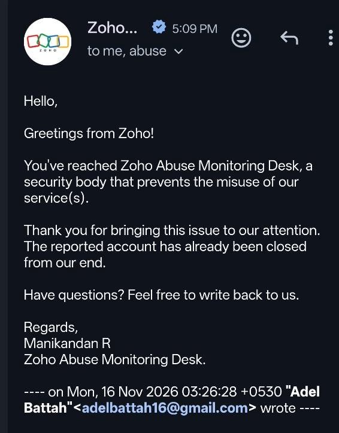

# Real-World Incident Response & Threat Hunting: SaaS Relay Abuse & Typosquatted Phishing

[](https://www.python.org/)
[](LICENSE)
[](docs/Incident_Report_IR-2026-1115-001-v2.pdf)
[](https://github.com/AdelBattah)

A forensic investigation, operational case study, and automated detection engine analyzing an evasive credential-harvesting campaign masquerading as domain registrar **Porkbun LLC**.

This repository documents the full incident lifecycle: from email delivery bypassing traditional email authentication controls via legitimate transactional SaaS relays, to infrastructure teardown, tactical threat hunting rules, and a standalone zero-dependency Python parser for SOC triage.

---

## Technical Artifacts & Documentation

- **Full Incident Report (PDF)**: [`docs/Incident_Report_IR-2026-1115-001-v2.pdf`](docs/Incident_Report_IR-2026-1115-001-v2.pdf)  
  *Comprehensive 4-page technical analysis covering threat actor attribution, delivery vectors, SPF/DKIM/DMARC circumvention, infrastructure topology, and provider abuse escalation.*
- **Automated SOC Triage Script**: [`src/eml_ioc_extractor.py`](src/eml_ioc_extractor.py)  
  *Zero-dependency CLI tool extracting defanged IOCs, analyzing authentication headers, calculating heuristic risk scores, and generating structured JSON for SIEM/SOAR ingestion.*
- **Detection Rules**:
  - YARA: [`rules/yara_split_infra_phish.yar`](rules/yara_split_infra_phish.yar)
  - Sigma: [`rules/sigma_saas_relay_spoof.yml`](rules/sigma_saas_relay_spoof.yml)
- **Sanitized Incident Samples**: [`samples/`](samples/)

---

## Incident Overview: What Happened?

In November 2026, an adversary launched a targeted spearphishing campaign impersonating Porkbun domain billing notifications (*"Keep your services running smoothly"*). The attack utilized a sophisticated delivery pipeline designed to bypass email security gateways:

```
[Adversary]
     │
     ▼
[Abused Zoho Books SaaS Tenant (org_id: 944707351)]
     │ (Legitimate DKIM + SPF signed by transmail.net)
     ▼
[Target Mail Server / Porkbun MX Forwarder]
     │ (SRS Rewriting: SRS0=9A4x=JE=paomusic.info=admin@porkbun-email.com)
     ▼
[Recipient Mailbox] ──► DMARC PASS (p=quarantine bypassed via third-party relay alignment)
     │
     ▼
[Lure Click: wwaccoountv[.]ecuiliber[.]com]
     ├─► Root domain (ecuiliber[.]com) -> Google Cloud (35.204.150.5, benign decoy)
     └─► Subdomain payload             -> Unified Layer (50.6.207.121, credential harvester)
```

### Key Attack Characteristics

1. **SaaS Transactional Relay Exploitation**:
   - The adversary abused an active Zoho Books organization tenant (`ahram`, ID `944707351`) routing through `system-72.transmail.net`.
   - Because the email originated from Zoho's authenticated infrastructure, SPF, DKIM, and DMARC evaluated to valid cryptographic passes on recipient security gateways.

2. **Split Infrastructure & Decoy Routing**:
   - The registered apex domain `ecuiliber[.]com` pointed to Google Cloud European infrastructure (`35.204.150.5`), presenting a legitimate default web hosting landing page.
   - The credential harvesting payload was hosted on a distinct subdomain `wwaccoountv[.]ecuiliber[.]com` residing on Newfold Digital / Unified Layer shared hosting (`50.6.207.121`), using a Let's Encrypt certificate provisioned less than 24 hours prior to detection.

3. **Repetition-Based Typosquatting**:
   - Subdomain label `wwaccoountv` used repeated characters (`ww`, `ccoou`) to evade automated token-based lexicon filters while visually appearing plausible to hurried users.

### Campaign Evolution: Wave 3 Adversary Pivot (Subdomain Hijacking)

Following the takedown of the abused Zoho Books tenant and registrar escalation against `ecuiliber[.]com`, the adversary adapted their tactics in **Wave 3** (November 17, 2026):

- **Delivery Pivot to Direct VPS**: Switched delivery from SaaS relays to direct SMTP injection from a dedicated French VPS (`213[.]156[.]134[.]117`, `vps125957.serveur-vps.net`) using an attacker-controlled high-abuse domain (`admin@paomusic[.]info`).
- **Subdomain Hijacking on Aged Infrastructure (`T1584.001`)**: Rather than purchasing fresh throwaway domains that trigger newly-registered domain (NRD) security filters, the adversary compromised the DNS/hosting of an authentic Danish domain (`birdwatching[.]dk`, registered in April 2019 via Punktum.dk).
- **Rogue Certificate Provisioning**: The threat actor spawned a rogue subdomain `wwwaccountv[.]birdwatching[.]dk` on Bluehost / Unified Layer (`50.6.207.121`), provisioning a fresh Let's Encrypt TLS certificate on November 17, 2026 (valid for 90 days) to harvest Porkbun account credentials under the guise of an authentic, aged root domain.

---

## Incident Response & Takedown Actions

Immediate active defense measures were executed across registrar, cloud, and hosting providers:

| Provider | Target Entity / Role | Action Taken | Status / Resolution |
| :--- | :--- | :--- | :--- |
| **Zoho Corporation** | Abuse Desk (`abuse@zohocorp.com`) | Tenant suspension request for compromised Org `944707351` | **CONFIRMED RESOLVED** (Account terminated via Ticket ## 6062928 ##) |
| **Openprovider** | Registrar for `ecuiliber[.]com` | Abuse escalation filed (Ticket IDs: #83114519, #83114531) | Escalated to Trust & Safety for domain suspension |
| **Newfold Digital / Bluehost** | Host for payload IP `50.6.207.121` | Malicious host report and credential collector suspension | 48-Hour Enforcement Notice issued (Case `ABU-203143`) |
| **Google Cloud Trust & Safety** | Apex host IP `35.204.150.5` | Abuse report regarding decoy infrastructure support | Submitted |
| **Porkbun LLC** | Impersonated Entity | Security notification regarding brand spoofing campaign | **CONFIRMED ACKNOWLEDGED** (Internal security tracking) |
| **Google Safe Browsing & Microsoft** | Malicious URLs | Global client-side blacklist submissions | Client-side protection active |

### Confirmed Remediation (Zoho Abuse Desk)

On **16 November 2026**, the **Zoho Abuse Monitoring Desk** confirmed the closure of the fraudulent tenant account:

> *"Thank you for bringing this issue to our attention. The reported account has already been closed from our end."*  
> — Manikandan R, Zoho Abuse Monitoring Desk

<p align="center">
  
</p>

---

## MITRE ATT&CK Mapping

| Tactic | Technique ID | Technique Name | Implementation in Attack |
| :--- | :--- | :--- | :--- |
| **Resource Development** | `T1583.001` | Acquire Infrastructure: Domains | Registration of `ecuiliber[.]com` via Openprovider |
| **Resource Development** | `T1583.006` | Acquire Infrastructure: Web Services | Exploitation of Zoho Books transactional relay |
| **Resource Development** | `T1584.001` | Compromise Infrastructure: Domains | Subdomain hijacking on legitimate domain `birdwatching[.]dk` (Wave 3) |
| **Resource Development** | `T1588.004` | Obtain Capabilities: Digital Certificates | Short-lived Let's Encrypt TLS certificates |
| **Initial Access** | `T1566.002` | Phishing: Spearphishing Link | Lure directing victim to fake payment review portal |
| **Defense Evasion** | `T1036.005` | Masquerading: Match Legitimate Name | Display name spoofing (*"Support Team"* / *"Porkbun"*) |
| **Credential Access** | `T1114` | Email Collection | Harvesting credentials through spoofed authentication form |

---

## SOC Forensic Tool: `eml_ioc_extractor.py`

This repository includes a standalone Python utility created during this investigation. It operates with **zero third-party dependencies** (standard Python library only).

### Capabilities
- **RFC-822 Parsing**: Extracts full header chains, authentication results (SPF, DKIM, DMARC), and raw envelope paths.
- **Defanging & Dual Output**: Outputs both raw and defanged (`hxxps://`, `[.]`) observables for safe terminal handling and direct SOAR/SIEM ingestion.
- **Dynamic Heuristic Scoring**: Evaluates display name mismatches, abused SaaS relays, typosquatting patterns, and high-risk TLDs.
- **Live Infrastructure Probing**: Performs passive DNS resolution, reverse PTR lookups, and TLS certificate age verification.
- **PII Redaction**: `--sanitize` flag scrubs recipient identities to enable safe report sharing.
- **Automation Ready**: Returns standard exit codes (`0` Clean, `1` Suspicious, `2` Critical Phishing) for CI/CD and SOAR playbooks.

### CLI Usage

```bash
# Run verification test suite (validates detection, scoring & defanging)
python test_pipeline.py

# Basic inspection of an EML file
python src/eml_ioc_extractor.py samples/incident_email1_zoho_relay_sanitized.eml

# Deep triage with live TLS and DNS telemetry + sanitized JSON export
python src/eml_ioc_extractor.py --enrich --sanitize -o forensic_report.json samples/*.eml
```

---

## Author & Contact

**Adel Battah**  
- GitHub: [@AdelBattah](https://github.com/AdelBattah)  
- Email: adelbattah16@gmail.com
